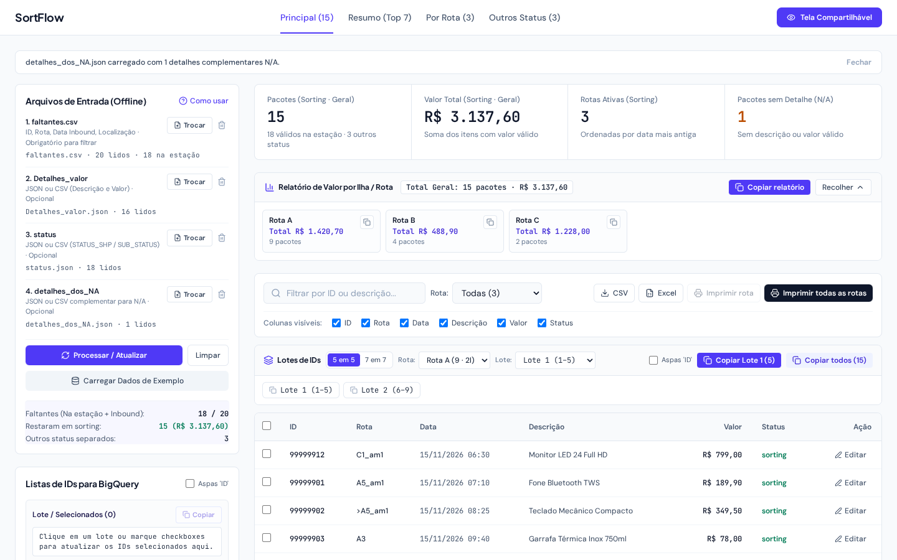
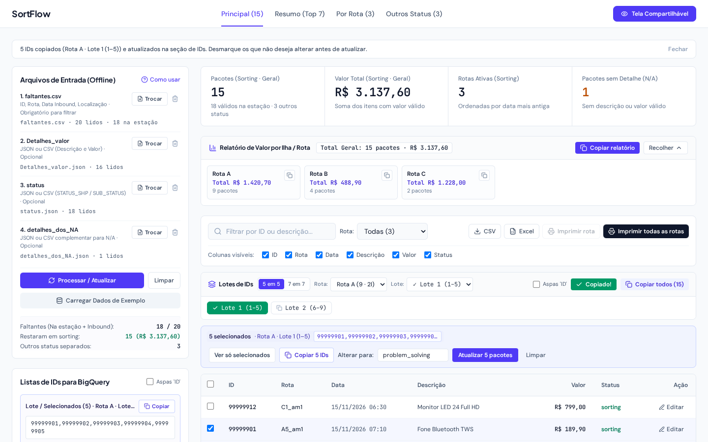
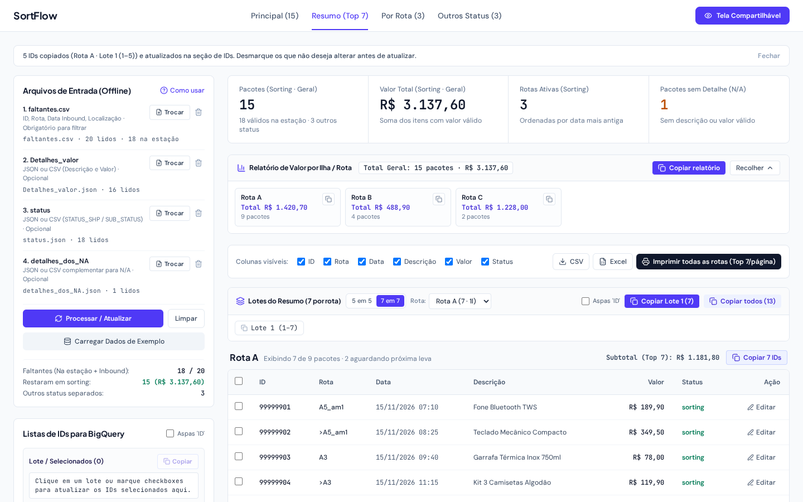
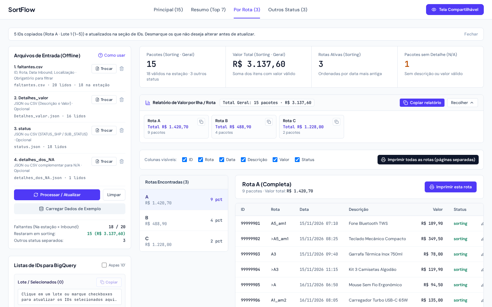
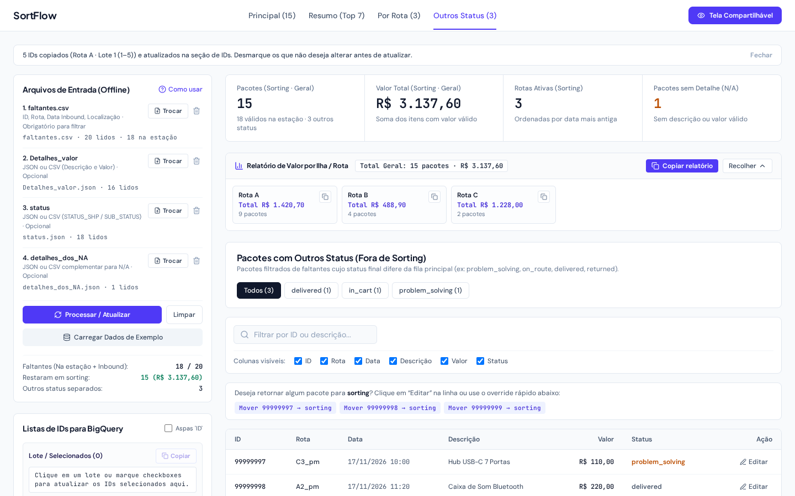

# SortFlow — Controle Logístico de Pacotes em Sorting

Aplicação web **100% offline (client-side)** para controle operacional de pacotes em sorting, desenvolvida para substituir planilhas manuais no fluxo diário entre consultas do **BigQuery** e a operação de estação.

Todos os arquivos carregados são processados localmente no navegador, sem envio de dados para servidores externos.

---

## Sumário

- [Visão Geral do Fluxo](#-visão-geral-do-fluxo)
- [Telas da Aplicação](#-telas-da-aplicação)
- [Arquivos de Entrada e Formatos Aceitos](#-arquivos-de-entrada-e-formatos-aceitos)
- [Regras de Processamento e Negócio](#-regras-de-processamento-e-negócio)
- [Funcionalidades Operacionais](#-funcionalidades-operacionais)
- [Estrutura do Projeto](#-estrutura-do-projeto)
- [Como Executar e Testar](#-como-executar-e-testar)
- [Privacidade e Persistência Local](#-privacidade-e-persistência-local)

---

## 🔄 Visão Geral do Fluxo

1. **Exportar no BigQuery**: rode sua query de faltantes e exporte o arquivo `faltantes.csv`.
2. **Importar no SortFlow**: envie o `faltantes.csv` na barra lateral — a aplicação aplica automaticamente os filtros obrigatórios e gera a string de IDs pronta para colar no `IN (...)` do BigQuery.
3. **Complementar Detalhes e Status**: envie opcionalmente `Detalhes_valor`, `status` e `detalhes_dos_NA` (em `.json`, `.ndjson` ou `.csv`).
4. **Operar por Rota e Lotes**: copie lotes de IDs (5 em 5 ou 7 em 7), marque/desmarque pacotes na tabela, aplique status manuais em massa, copie o relatório de valores por ilha/rota e exporte ou imprima as listas organizadas por rota.

---

## 🖥️ Telas da Aplicação

### 1. Tela Principal e Relatório de Valor por Ilha / Rota
Visão geral com KPIs preservando o **Total Geral**, painel **Relatório de Valor por Ilha / Rota** (com botão **Copiar relatório** e cópia individual por rota), barra de filtros/colunas/exportação e tabela ordenada por data mais antiga e rota.



### 2. Lotes de IDs, Seleção em Tabela e Status Manual Sincronizados
Ao clicar em um lote (ex.: `Lote 1 (1–5)`), os IDs são copiados, os checkboxes correspondentes são marcados na tabela e as seções **Lote / Selecionados** (barra lateral) e **Status Manual** são atualizadas instantaneamente. O operador pode desmarcar exceções antes de aplicar o novo status em lote.



### 3. Resumo (Top 7 por Rota)
Exibe os **7 primeiros pacotes mais antigos de cada rota**, com subtotal do Top 7, botão rápido para copiar os IDs de cada rota e lotes dedicados `7 em 7`.



### 4. Separação Completa por Rota
Diretório lateral com todas as rotas ativas, quantidade de pacotes, valor acumulado da rota e botão **Imprimir esta rota** ou **Imprimir todas as rotas (páginas separadas)**.



### 5. Outros Status (Fora de Sorting)
Separa automaticamente pacotes com status final diferente de `sorting` (ex.: `problem_solving`, `delivered`, `in_cart`, `on_route`, `returned`), permitindo filtrar por status ou retornar um pacote para `sorting` com um clique.



---

## 📂 Arquivos de Entrada e Formatos Aceitos

> **Observação:** Todos os exemplos abaixo utilizam IDs fictícios (`99999901` a `99999999`) apenas para fins de documentação.

A barra lateral aceita **CSV** (vírgula `,` ou ponto-e-vírgula `;`, UTF-8 ou Windows-1252) e **JSON** (array de objetos, objeto wrapper ou NDJSON exportado pelo BigQuery). Os nomes das colunas são detectados automaticamente mesmo com variações de maiúsculas, espaços ou acentuação.

### 1. `faltantes.csv` *(Obrigatório para iniciar)*
* **Colunas detectadas automaticamente:**
  * `ID do pacote` / `ID` / `SHP_SHIPMENT_ID`
  * `N.º Rota` / `Rota`
  * `Data de Inbound` / `Data`
  * `Localização do pacote` / `Localizacao`
* **Filtro obrigatório:** mantém apenas linhas com **Data de Inbound preenchida** E **Localização = "Na estação"** (aceita variações sem acento, como `na estacao`).

```csv
ID do pacote,N.º Rota,Data de Inbound,Localização do pacote
99999901,A5_am1,15/11/2026 07:10,Na estação
99999902,>A5_am1,15/11/2026 08:25,Na estação
99999999,B1_pm,17/11/2026 12:00,Na estação
```

### 2. `Detalhes_valor.json` ou `.csv` *(Opcional)*
* **Colunas detectadas:**
  * `ID` / `SHP_SHIPMENT_ID` / `PEDIDO`
  * `DESCRICAO` / `SHP_ITEM_DESC`
  * `VALOR_REAL` / `SHP_ORDER_COST` / `Valor`

```json
[
  { "ID": "99999901", "DESCRICAO": "Fone Bluetooth TWS", "VALOR_REAL": 189.90 },
  { "ID": "99999999", "DESCRICAO": "Webcam Full HD 1080p", "VALOR_REAL": 175.00 }
]
```

### 3. `status.json` ou `.csv` *(Opcional)*
* **Colunas detectadas:**
  * `ID`
  * `STATUS_SHP`
  * `SUB_STATUS`
  * `LAST_UPD` *(opcional — quando há múltiplos registros do mesmo ID, prevalece o mais recente)*

```json
[
  { "ID": "99999901", "STATUS_SHP": "in_hub", "SUB_STATUS": "sorting" },
  { "ID": "99999999", "STATUS_SHP": "in_cart", "SUB_STATUS": "" }
]
```

### 4. `detalhes_dos_NA.json` ou `.csv` *(Opcional)*
* Mesma estrutura de `Detalhes_valor`. Utilizado como complemento para preencher **Descrição** e **Valor** dos pacotes que permaneceram como `N/A`.

---

## ⚙️ Regras de Processamento e Negócio

1. **Prioridade de origem dos campos:**
   * **Rota** e **Data** vêm de `faltantes`.
   * **Descrição** e **Valor** vêm de `Detalhes_valor` e, quando ausentes (`N/A`), recorrem a `detalhes_dos_NA`.
2. **Regra do Status Final:**
   * Se `SUB_STATUS` for `"sorting"` ou `"problem_solving"`, o status final assume `SUB_STATUS`.
   * Caso contrário, utiliza `STATUS_SHP`.
   * **Arquivo `status` ausente:** todos os pacotes válidos de `faltantes` são exibidos com status padrão **`pendente`**.
   * **Arquivo `status` carregado:** a fila principal mantém apenas pacotes com status final **`sorting`** e separa os demais na aba **Outros Status**.
3. **Override Manual (Precedência Total):**
   * Alterações manuais de status (individuais ou em lote) **sempre vencem** o status vindo do arquivo e atualizam imediatamente contadores, tabelas, listas e relatórios.
4. **Agrupamento de Ilhas / Rotas:**
   * Sub-rotas operacionais como `A5_am1`, `>A5_am1`, `A3` e `>A` são agrupadas sob a ilha/rota **`A`** para relatórios, lotes e separação por rota, preservando a rota original na coluna da tabela.
5. **Ordenação Padrão:**
   * Data de Inbound mais antiga primeiro (`dataTimestamp` crescente), seguida de rota e ID.

---

## ✨ Funcionalidades Operacionais

### Listas de IDs para BigQuery
* **`Lote / Selecionados`**: atualizado em tempo real sempre que um lote é copiado ou checkboxes da tabela são alterados.
* **`1. IDs para Status`**: todos os IDs válidos de `faltantes` (Inbound + Na estação), separados por vírgula.
* **`2. IDs que estão N/A`**: apenas os IDs filtrados sem descrição ou valor válidos (exibe `"Nenhum pacote N/A"` quando zerado).
* **Checkbox `Aspas 'ID'`**: formata qualquer lista como `'99999901','99999902','99999999'` para colar diretamente em `WHERE ID IN (...)` no BigQuery.

### Relatório de Valor por Ilha / Rota
* Exibe o **Total Geral** (quantidade de pacotes + valor total) mesmo quando um filtro de rota está ativo na tabela.
* Calcula o total financeiro e a contagem de pacotes de cada ilha/rota (`Rota A Total R$ ...`).
* Botão **Copiar relatório** (copia o resumo geral + detalhamento de todas as rotas) e botão individual em cada card para copiar apenas aquela rota.

### Exportação, Impressão e Tela Compartilhável
* **Colunas configuráveis**: selecione quais colunas (`ID`, `Rota`, `Data`, `Descrição`, `Valor`, `Status`) ficam visíveis em tela, nas exportações e na impressão.
* **Exportação**: gere arquivos `.csv` (UTF-8 com BOM para Excel PT-BR) ou `.xlsx` nativo.
* **Impressão A4 Paisagem**: imprima apenas a rota selecionada ou todas as rotas/resumos Top 7 com quebra de página automática por rota.
* **Tela Compartilhável**: modo somente leitura (`?mode=shared`) ocultando a barra de ingestão lateral para exibição em monitores da operação.

---

## 🗂️ Estrutura do Projeto

```text
├── docs/
│   └── images/                  # Capturas de tela usadas na documentação
├── src/
│   ├── components/
│   │   ├── BatchIdCopier.tsx    # Cópia de IDs em lotes (5 em 5 / 7 em 7)
│   │   ├── Header.tsx           # Navegação entre telas e modo compartilhável
│   │   ├── IngestionSidebar.tsx # Upload offline, listas BigQuery e override manual
│   │   ├── KpiStrip.tsx         # Indicadores gerais e comparativo do filtro atual
│   │   ├── OtherStatusView.tsx  # Visualização de pacotes fora de sorting
│   │   ├── PackagesTable.tsx    # Tabela principal com seleção e ações inline
│   │   ├── PrintSheet.tsx       # Folha de impressão dedicada por rota (landscape)
│   │   ├── ResumoView.tsx       # Top 7 pacotes mais antigos por rota
│   │   ├── RouteValueReport.tsx # Cálculo e cópia de valor por ilha/rota + total geral
│   │   ├── RoutesView.tsx       # Separação completa por rota
│   │   ├── TableToolbar.tsx     # Busca, filtro de rota, colunas e exportação
│   │   └── UsageGuideModal.tsx  # Modal de referência rápida dentro do app
│   ├── data/
│   │   └── demoData.ts          # Conjunto de dados de demonstração embutido
│   ├── types/
│   │   └── logistics.ts         # Contratos TypeScript do domínio logístico
│   ├── utils/
│   │   ├── batches.ts           # Agrupamento e formatação de lotes de IDs
│   │   ├── exporters.ts         # Exportadores CSV e Excel (.xlsx)
│   │   ├── fileParsers.ts       # Parsers inteligentes CSV / JSON / NDJSON
│   │   ├── idChunker.ts         # Utilitários de clipboard e fragmentação de IDs
│   │   ├── normalizers.ts       # Normalização de IDs, datas, moeda BRL e status
│   │   ├── processor.ts         # Motor de cruzamento, filtros e overrides
│   │   ├── routeReport.ts       # Formatação do relatório financeiro por rota
│   │   └── *.test.ts            # Suíte de testes unitários (node:test via tsx)
│   ├── App.tsx                  # Orquestração de estado, filtros e sincronização
│   ├── index.css                # Estilos Tailwind v4, animações e regras @media print
│   └── main.tsx                 # Ponto de entrada React
├── index.html
├── package.json
├── tsconfig.json
└── vite.config.ts
```

---

## 🚀 Como Executar e Testar

### Pré-requisitos
* **Node.js** 20+ e **npm**

### Instalação e desenvolvimento
```bash
npm install
npm run dev
```
A aplicação estará disponível em `http://localhost:3000`.

### Testes, Verificação de Tipos e Build de Produção
```bash
# Executar todos os testes unitários
npm test

# Verificar tipagem TypeScript
npm run lint

# Gerar build de produção (pasta dist/)
npm run build
```

---

## 🔒 Privacidade e Persistência Local

* **100% Offline no Navegador**: nenhum arquivo enviado sai da máquina do usuário.
* **Persistência via `localStorage`**: os últimos dados carregados, overrides manuais aplicados e preferências de colunas visíveis são salvos localmente no navegador para evitar retrabalho ao recarregar a página, podendo ser apagados a qualquer momento pelo botão **Limpar**.
